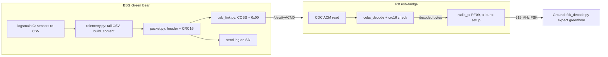

# Green Bear USB Telemetry Plan

Launch is tomorrow. Goal: BBG logs sensors continuously to SD, sends telemetry packets over USB to the RB every ~20 s, RB radiates them unchanged, ground station decodes them. One-way, no ACKs. OLAF and CAN are out of the launch path but left in the tree.

## Decisions (from the grill session, 2026-11-07)

**A. Scope**
1. **Launch-day minimum** — BBG→RB→radio→ground chain works for minutes post-launch; every sent packet logged on SD.
2. **Repo hygiene** — Commit the untracked usbeast scraps to the `usbeast` branches as an archive, then leave them. Apply `stash@{0}` (`.gitignore`, README line); drop the empty `packets/packer.py`. New branch `greenbear` from `main` (this repo) and from `claudette` (RF repo).
3. **OLAF** — Out of the launch path; `main.py`, `resources/`, `services/services.py` untouched. `oresat-olaf` moves to `[project.optional-dependencies] olaf`.
4. **Flight loop** — New Python entry point **Green Bear**. `flightmain.c` and `flightmain.service` deleted (obsolete extruder mission). `logsmain` (C) stays the sole sensor reader and CSV logger, untouched; Green Bear tails its CSV. `batteryheater` untouched. GPS excluded.
5. **RB firmware** — In scope: minimal "USB in, radio out" bridge in the RF repo.

**B. Transport**
1. USB CDC ACM; RB appears as `/dev/ttyACM0`.
2. One-way fire-and-forget. No ACK/retry/kinds. Sequence number only for gap detection.
3. Device path is one config value, default `/dev/ttyACM0`.
4. Link absence never blocks logging: open-with-retry every few seconds, write failures logged, packet still written to send log.
5. Nothing flows RB→BBG. RB status goes to its SERCOM5 debug console via `printk`.

**C. Packet** (header is addressed to the ground, not the RB)
1–3. 16-byte header, little-endian; callsign `VE3 JKB` first as sync word + ID; one version byte.
4. `MAX_CONTENT = 1024` (absolute ceiling 2025 = 2043 usable PSDU − 16 − 2). One constant on both sides.
5. Plain COBS, trailing `0x00` delimiter, USB-only (RB strips it).
6. CRC-16/CCITT-FALSE (poly `0x1021`, init `0xFFFF`, no reflection, no xorout; check `b"123456789"` → `0x29B1`). Covers header+content, stored LE after content, computed before COBS, travels to ground. Python: `binascii.crc_hqx(data, 0xFFFF)`; C: Zephyr `crc16_itu_t(0xFFFF, ...)`.
7. Layout 2: RB does COBS-decode + CRC check + length check, then `radio_tx` the decoded bytes verbatim. Chip appends its own CRC-32 FCS.

```
offset size field     type   meaning
0      7    callsign  ASCII  "VE3 JKB"
7      1    version   u8     1
8      2    seq       u16    wraps at 65535
10     4    time      u32    Unix seconds at send (sync BBG clock pre-flight)
14     2    length    u16    content byte count
16     ..   content   bytes  user-packed (int16 vs float32: deferred)
end    2    crc16     u16    CCITT-FALSE over offset 0..end of content
```

**D. BBG code**
1. Package `Ion/src/ion/greenbear/`: `config.py`, `cobs.py`, `packet.py`, `usb_link.py`, `telemetry.py`, `main.py`; tests in `Ion/tests/`, one per module. Script entry `greenbear = "ion.greenbear.main:main"`.
2. `pyserial` dependency.
3. Stdlib `unittest` via `make test`. `FakeLink` records frames. Fixture CSV from a real `ionNNN.csv`. Small `tools/decode_frame.py` for bench/post-mortem.
4. User slot: `telemetry.build_content(rows: list[Sample]) -> bytes`. Loop: every `PACKET_INTERVAL_S` (20), read CSV rows newer than last send → `build_content` → `packet.build` → `link.send` → append send-log line (`wall time, seq, len, sent|link down, frame hex`) to `/home/cubesat/logs/greenbear_NNN.log`.
5. `greenbear.service` (`uv run greenbear`, `After=logsmain.service`, `Restart=always`, `StandardOutput=append:/home/cubesat/logs/greenbear-stdout.log`). Makefile `SERVICES := batteryheater logsmain greenbear`. `logs.c` untouched (late lines ride in the next packet).

**User-written bodies (skeleton + full tests by agent):** `cobs.encode/decode`, `packet.build/parse`, `telemetry.build_content`. Fallback: if not green at integration time, agent fills and user reviews. `[Deferred: content number format, decide when writing build_content]`

**E. Process**
1. Branches `greenbear` (both repos).
2. `docs/greenbear-design.md` (this decision record + rationale) and `docs/greenbear-protocol.md` (byte spec + vectors) in this repo; RF firmware links to it. READMEs are the user's. RGB migration stub at end of design doc.
3. Four steps below; user approves each step's diff before the next.

**F. Ground station** — `fsk_decode.py --expect greenbear` parses and prints header live, using a copy of `packet.py` in `ground-station/` marked "copied, keep in sync".

**G. RB firmware** — `software/apps/usb-bridge/` in RF repo. Radio path byte-for-byte from `tx-burst` (RF24 asleep, RF09, preset 0, `TX_POWER 15`, TRXOFF after each send). CDC ACM via Zephyr UART API, accumulator ~1100 bytes, split on `0x00`, `cobs_decode` (own ~30-line C), `crc16_itu_t`, length check, `radio_tx`. One `printk` per frame. Bad frames dropped and counted. Re-apply the usbeast `.dts` CDC ACM node + USB pinmux under a neutral label; `prj.conf` without CAN.

## Architecture



## Step 1: Foundations (both repos)

- Git: archive usbeast scraps on `usbeast` (both repos), `git switch -c greenbear main`, `git stash apply`, remove empty `Ion/src/ion/packets/`. RF repo: `greenbear` from `claudette`.
- `Ion/pyproject.toml`: add `pyserial`; move `oresat-olaf` to optional extra `olaf`; add `greenbear` script. `uv lock`.
- Create `Ion/src/ion/greenbear/` with all six files: full signatures, docstrings stating input/output types and rules; `cobs.py` and `packet.py` bodies are `raise NotImplementedError` (user's). `config.py` complete.
- Tests: `test_cobs.py` (published vectors, empty, all-zero, all-byte-values, 254/255-byte runs, round trips, malformed input), `test_packet.py` (round trip, max size accepted, max+1 rejected, truncation, bad CRC, bad callsign, bad version, CRC check value 0x29B1). Makefile `test` target kept.
- Write `docs/greenbear-design.md` and `docs/greenbear-protocol.md` (include RGB stub + note-to-self).
- Done when: `make test` runs; only cobs/packet tests fail with NotImplementedError.
- **Context clear point after step 1 is optional; after step 2 recommended.**

## Step 2: Green Bear on the BBG

- `usb_link.py`: `UsbLink(path)` open-with-retry, `send(frame: bytes) -> bool`, never raises; `FakeLink` same interface.
- `telemetry.py`: `Sample` dataclass mirroring one `logs.c` CSV line; `read_new_rows(csv_dir, since)`; `build_content` skeleton (user's).
- `main.py`: ~40-line loop; send log writer; `logging` to stdout.
- `systemd-services/greenbear.service`; delete `flightmain.service`, `flightmain.c`, Makefile flightmain target; update `SERVICES`.
- `tools/decode_frame.py`.
- `test_usb_link.py`, `test_telemetry.py`, `test_main.py` (fixture CSV + FakeLink end-to-end once cobs/packet are green; until then uses a trivial stand-in content).
- Done when: full loop runs on laptop against fixture CSV; on BBG, `uv run greenbear` writes frames or logs "link down"; `make install-services` works.

## Step 3: RB bridge + ground parser (RF repo)

- `software/apps/usb-bridge/{CMakeLists.txt,prj.conf,src/main.c,src/cobs.c,src/cobs.h}`.
- `.dts`: CDC ACM node + USB pinmux (from usbeast scraps, renamed). Console stays SERCOM5.
- Host-side C test for `cobs_decode` with the same vectors (plain `gcc`, no Zephyr).
- `ground-station/greenbear_packet.py` (copy) + `--expect greenbear` in `fsk_decode.py` printing callsign/seq/time/len/crc16 ok.
- Done when: firmware builds and flashes; frame sent from BBG appears on RB console as `sent`; HackRF decode prints header.
- **Separate session; natural context boundary.**

## Step 4: Integration + pre-flight checklist

- Bench: BBG + RB + HackRF end to end for 10+ minutes; verify seq continuity in send log vs ground.
- Checklist: BBG clock synced (`internetToBBG.sh`), `/home/cubesat/logs` exists and writable, `greenbear`+`logsmain`+`batteryheater` enabled, RB flashed with usb-bridge, antenna on J3 before power, TX power as tx-burst, ground flowgraph tuned as for tx-burst.

## Human-in-the-loop slots

- After step 1: write `cobs.py` bodies, then `packet.py` bodies (tests are the spec).
- After step 2: write `build_content` (decide int16 vs float32 then).
- Before step 3: review `docs/greenbear-protocol.md`.
- Before each step: approve previous step's diff.

## RGB USB migration stub (future, out of scope)

Placeholder to be expanded in `docs/greenbear-design.md`: the RB today is transmit-only. A full migration would open: RB→BBG receive path and command set, radio configuration over USB (channel, power, preset), replacement for the CAN heartbeat, whether the RB should buffer/retransmit, and what the GB/CAN-FD connector becomes. **Note to self: replace this stub with real specs after the flight, informed by what the bench and flight logs show.**

## Agent-driven work starts

Immediately on approval of this plan, with step 1. User is only needed at the HITL slots and at the bench for step 4.