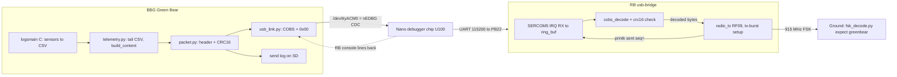

# Green Bear USB Telemetry Plan

Launch is tomorrow. Goal: BBG logs sensors continuously to SD, sends telemetry packets over USB to the RB every ~20 s, RB radiates them unchanged, ground station decodes them. One-way, no ACKs. OLAF and CAN are out of the launch path but left in the tree.

## Status (2026-11-07 16:00)

- Steps 1–3 are done and pushed on `greenbear` in both repos (Ion `042a0d2`, RF `a442c5d`). Ground station decodes Green Bear live via `ground-station/GNUradio/fsk_demod.py`.
- **Bench result: BBG reported `sent`, RB never radiated.** Root cause (deep dive, 2026-11-07 15:40): on the SAMD21 Curiosity Nano the micro-B jack is wired to the **nEDBG debugger chip** (U100), not to the target's `PA24/PA25`. On the Green Board, `PA24/PA25` go only to the MCP251863 `~INT0/~INT1` pins (inputs at reset; harmless, nothing was damaged). So `/dev/ttyACM0` on the BBG is the debugger's CDC port, whose bytes land on **SERCOM5 RX (PB22)**, the RB console UART, which the usb-bridge firmware never read. The target CDC ACM device was attached to nothing.
- Decision: **Step 3b** below replaces the target-USB transport with SERCOM5 through the debugger CDC. Same cable, no wiring. Decisions B.1/B.5/G are superseded where noted.
- The uncommitted `device-tree/BBG-ION-0.dtso` UART4 edit (RB console tap on P9_11) is obsolete: the RB console now arrives on `/dev/ttyACM0` for free. Revert it.
- **Step 3b code is pushed** (RF `7800c0b`; Ion: this commit). usb-bridge builds at RAM 58.79 % (9632 B / 16 KB), flash 17.87 %. Ion `make test`: the 60 pre-existing `NotImplementedError`s from the unfilled `cdh_packets` cobs/packet bodies remain; everything else green including the new `read_pending` / `rb:` log tests. Bench (Step 4) pending.

## Decisions (from the grill session, 2026-11-07)

**A. Scope**
1. **Launch-day minimum** — BBG→RB→radio→ground chain works for minutes post-launch; every sent packet logged on SD.
2. **Repo hygiene** — Commit the untracked usbeast scraps to the `usbeast` branches as an archive, then leave them. Apply `stash@{0}` (`.gitignore`, README line); drop the empty `packets/packer.py`. New branch `greenbear` from `main` (this repo) and from `claudette` (RF repo).
3. **OLAF** — Out of the launch path; `main.py`, `resources/`, `services/services.py` untouched. `oresat-olaf` moves to `[project.optional-dependencies] olaf`.
4. **Flight loop** — New Python entry point **Green Bear**. `flightmain.c` and `flightmain.service` deleted (obsolete extruder mission). `logsmain` (C) stays the sole sensor reader and CSV logger, untouched; Green Bear tails its CSV. `batteryheater` untouched. GPS excluded.
5. **RB firmware** — In scope: minimal "USB in, radio out" bridge in the RF repo.

**B. Transport** *(B.1 and B.5 superseded by Step 3b: the port is the Nano debugger's CDC, bytes reach the RB on SERCOM5 at 115200 8N1; RB `printk` output comes back on the same port.)*
1. ~~USB CDC ACM; RB appears as `/dev/ttyACM0`.~~ `/dev/ttyACM0` is the nEDBG CDC-to-UART bridge; RB reads SERCOM5.
2. One-way fire-and-forget. No ACK/retry/kinds. Sequence number only for gap detection.
3. Device path is one config value, default `/dev/ttyACM0`.
4. Link absence never blocks logging: open-with-retry every few seconds, write failures logged, packet still written to send log.
5. Nothing flows RB→BBG. RB status goes to its SERCOM5 debug console via `printk`.

**C. Packet** (header is addressed to the ground, not the RB)
1–3. 16-byte header, little-endian; callsign `VE3 JKB` first as sync word + ID; one version byte.
4. `MAX_CONTENT = 1024` (absolute ceiling 2025 = 2043 usable PSDU − 16 − 2). One constant on both sides.
5. Plain COBS, trailing `0x00` delimiter, USB-only (RB strips it).
6. CRC-16/CCITT-FALSE (poly `0x1021`, init `0xFFFF`, no reflection, no xorout; check `b"123456789"` → `0x29B1`). Covers header+content, stored LE after content, computed before COBS, travels to ground. Python: `binascii.crc_hqx(data, 0xFFFF)`; C: Zephyr `crc16_itu_t(0xFFFF, ...)`.
7. Layout 2: RB does COBS-decode + CRC check + length check, then `radio_tx` the decoded bytes verbatim. Chip appends its own CRC-32 FCS.

```
offset size field     type   meaning
0      7    callsign  ASCII  "VE3 JKB"
7      1    version   u8     1
8      2    seq       u16    wraps at 65535
10     4    time      u32    Unix seconds at send (sync BBG clock pre-flight)
14     2    length    u16    content byte count
16     ..   content   bytes  user-packed (int16 vs float32: deferred)
end    2    crc16     u16    CCITT-FALSE over offset 0..end of content
```

**D. BBG code**
1. Package `Ion/src/ion/greenbear/`: `config.py`, `cobs.py`, `packet.py`, `usb_link.py`, `telemetry.py`, `main.py`; tests in `Ion/tests/`, one per module. Script entry `greenbear = "ion.greenbear.main:main"`.
2. `pyserial` dependency.
3. Stdlib `unittest` via `make test`. `FakeLink` records frames. Fixture CSV from a real `ionNNN.csv`. Small `tools/decode_frame.py` for bench/post-mortem.
4. User slot: `telemetry.build_content(rows: list[Sample]) -> bytes`. Loop: every `PACKET_INTERVAL_S` (20), read CSV rows newer than last send → `build_content` → `packet.build` → `link.send` → append send-log line (`wall time, seq, len, sent|link down, frame hex`) to `/home/cubesat/logs/greenbear_NNN.log`.
5. `greenbear.service` (`uv run greenbear`, `After=logsmain.service`, `Restart=always`, `StandardOutput=append:/home/cubesat/logs/greenbear-stdout.log`). Makefile `SERVICES := batteryheater logsmain greenbear`. `logs.c` untouched (late lines ride in the next packet).

**User-written bodies (skeleton + full tests by agent):** `cobs.encode/decode`, `packet.build/parse`, `telemetry.build_content`. Fallback: if not green at integration time, agent fills and user reviews. `[Deferred: content number format, decide when writing build_content]`

**E. Process**
1. Branches `greenbear` (both repos).
2. `docs/greenbear-design.md` (this decision record + rationale) and `docs/greenbear-protocol.md` (byte spec + vectors) in this repo; RF firmware links to it. READMEs are the user's. RGB migration stub at end of design doc.
3. Four steps below; user approves each step's diff before the next.

**F. Ground station** — `fsk_decode.py --expect greenbear` parses and prints header live, using a copy of `packet.py` in `ground-station/` marked "copied, keep in sync".

**G. RB firmware** — `software/tests/usb-bridge/` in RF repo (lives under `tests/` to match the repo). Radio path byte-for-byte from `tx-burst` (RF24 asleep, RF09, preset 0, `TX_POWER 15`, TRXOFF after each send). ~~CDC ACM via Zephyr UART API~~ **Step 3b: input UART is `DT_CHOSEN(zephyr_console)` (SERCOM5), interrupt-driven RX into a ring buffer**; accumulator ~1100 bytes, split on `0x00`, `cobs_decode` (own ~30-line C), `crc16_itu_t`, length check, `radio_tx`. One `printk` per frame. Bad frames dropped and counted. ~~Re-apply the usbeast `.dts` CDC ACM node + USB pinmux~~ No USB stack, no DTS change; `prj.conf` without CAN.

## Architecture



## Step 1: Foundations (both repos)

- Git: archive usbeast scraps on `usbeast` (both repos), `git switch -c greenbear main`, `git stash apply`, remove empty `Ion/src/ion/packets/`. RF repo: `greenbear` from `claudette`.
- `Ion/pyproject.toml`: add `pyserial`; move `oresat-olaf` to optional extra `olaf`; add `greenbear` script. `uv lock`.
- Create `Ion/src/ion/greenbear/` with all six files: full signatures, docstrings stating input/output types and rules; `cobs.py` and `packet.py` bodies are `raise NotImplementedError` (user's). `config.py` complete.
- Tests: `test_cobs.py` (published vectors, empty, all-zero, all-byte-values, 254/255-byte runs, round trips, malformed input), `test_packet.py` (round trip, max size accepted, max+1 rejected, truncation, bad CRC, bad callsign, bad version, CRC check value 0x29B1). Makefile `test` target kept.
- Write `docs/greenbear-design.md` and `docs/greenbear-protocol.md` (include RGB stub + note-to-self).
- Done when: `make test` runs; only cobs/packet tests fail with NotImplementedError.
- **Context clear point after step 1 is optional; after step 2 recommended.**

## Step 2: Green Bear on the BBG

- `usb_link.py`: `UsbLink(path)` open-with-retry, `send(frame: bytes) -> bool`, never raises; `FakeLink` same interface.
- `telemetry.py`: `Sample` dataclass mirroring one `logs.c` CSV line; `read_new_rows(csv_dir, since)`; `build_content` skeleton (user's).
- `main.py`: ~40-line loop; send log writer; `logging` to stdout.
- `systemd-services/greenbear.service`; delete `flightmain.service`, `flightmain.c`, Makefile flightmain target; update `SERVICES`.
- `tools/decode_frame.py`.
- `test_usb_link.py`, `test_telemetry.py`, `test_main.py` (fixture CSV + FakeLink end-to-end once cobs/packet are green; until then uses a trivial stand-in content).
- Done when: full loop runs on laptop against fixture CSV; on BBG, `uv run greenbear` writes frames or logs "link down"; `make install-services` works.

## Step 3: RB bridge + ground parser (RF repo)

- `software/apps/usb-bridge/{CMakeLists.txt,prj.conf,src/main.c,src/cobs.c,src/cobs.h}`.
- `.dts`: CDC ACM node + USB pinmux (from usbeast scraps, renamed). Console stays SERCOM5.
- Host-side C test for `cobs_decode` with the same vectors (plain `gcc`, no Zephyr).
- `ground-station/greenbear_packet.py` (copy) + `--expect greenbear` in `fsk_decode.py` printing callsign/seq/time/len/crc16 ok.
- Done when: firmware builds and flashes; frame sent from BBG appears on RB console as `sent`; HackRF decode prints header.
- **Separate session; natural context boundary.**
- Status: code complete and pushed; bench showed the transport cannot work (see Status). Fixed by Step 3b.

## Step 3b: SERCOM5 pivot (both repos, `greenbear` branch)

Minimal change set. The wire protocol (COBS + `0x00`, header, CRC-16), the ground station, and the radio path are untouched.

**Why IRQ-driven RX is not optional:** the SAMD21 SERCOM RX holds 2 bytes. At 115200 a byte lands every ~87 µs; the current `uart_poll_in` loop with `k_msleep(1)` between empty polls would lose ~10 bytes per gap. A 1 KB frame streams ~90 ms back-to-back from the debugger bridge.

**RF repo — `software/tests/usb-bridge/`**
- `src/main.c`
  - Replace `DEVICE_DT_GET_ONE(zephyr_cdc_acm_uart)` with `DEVICE_DT_GET(DT_CHOSEN(zephyr_console))` (SERCOM5). Rename `cdc` → `uart`.
  - Add `RING_BUF_DECLARE(rx_rb, 2048)` + `K_SEM_DEFINE(rx_sem, 0, 1)`. ISR: `uart_irq_update`, while `uart_irq_rx_ready` → `uart_fifo_read` into a small stack buffer → `ring_buf_put` → `k_sem_give`. Install with `uart_irq_callback_user_data_set` + `uart_irq_rx_enable` in `main` after `radio_setup`.
  - Main loop: `k_sem_take(&rx_sem, K_FOREVER)`, drain `ring_buf_get` one byte at a time through the existing `feed_byte`. `handle_cobs_frame` (and `radio_tx`) stay in thread context. Remove the `k_msleep(1)` poll loop.
  - Keep every `printk`; they now reach the BBG. Change banner to `usb-bridge ready (uart=%s)`. Header comment: input is SERCOM5 via the Nano debugger CDC; `PA24/PA25` are not USB on this board.
- `prj.conf`: delete the six USB lines (`CONFIG_USB_DEVICE_STACK_NEXT`, `CONFIG_UART_LINE_CTRL`, `CONFIG_USBD_CDC_ACM_CLASS`, `CONFIG_CDC_ACM_SERIAL_INITIALIZE_AT_BOOT`, `CONFIG_CDC_ACM_SERIAL_PRODUCT_STRING`; keep `CONFIG_SERIAL=y`). Add `CONFIG_UART_INTERRUPT_DRIVEN=y`, `CONFIG_RING_BUFFER=y`.
- `software/boards/ocs_rf_1/ocs_rf_1.dts`: revert to `claudette` (`git checkout claudette -- software/boards/ocs_rf_1/ocs_rf_1.dts`), removing `zephyr_udc0`, `greenbear_cdc_acm`, `usb_dc_default`. SERCOM5 node already has `current-speed = <115200>`, `rxpo = <2>` (PB22), `txpo = <0>` (PA22).
- `README.md`: build/flash unchanged (`./.venv/bin/west build -b ocs_rf_1 -d build-usb-bridge tests/usb-bridge --pristine=always`, then `west flash`). Replace the console paragraph: the RB console is the Nano's virtual COM port; on the BBG it is `/dev/ttyACM0` and Green Bear logs it; on a laptop `picocom -b 115200 /dev/tty.usbmodem*`. Note that only one process should hold the port.
- Verify: build exits 0, RAM well under the previous 93 %; flash; from a laptop `python3 -c "import serial,sys; sys.path.insert(0,'ground-station'); import greenbear_packet as g; ..."` or simply `uv run greenbear --stub --once --device /dev/tty.usbmodem*` from the Ion repo on the Mac, and watch for `sent seq=` on the same port (open it read-only after, or use `--interval 5` and read the RB lines Green Bear logs).

**Ion repo — `Ion/src/ion/greenbear/`**
- `config.py`: `USB_BAUD` stays 115200; fix comment: *the nEDBG bridge applies this baud to SERCOM5; must match `current-speed` in `ocs_rf_1.dts`*. Add `RB_CONSOLE_LOG: bool = True`.
- `usb_link.py`: add `UsbLink.read_pending() -> bytes` (non-blocking `self._ser.read(self._ser.in_waiting)`, never raises, `b""` when closed). `FakeLink.read_pending()` returns `b""`. Add `read_pending` to the `Link` Protocol. Docstring: the port is the debugger CDC; bytes go to the RB console UART; RB `printk` comes back.
- `main.py`: at the top of each loop iteration, `pending = link.read_pending()`; decode `errors="replace"`, split lines, `logger.info("rb: %s", line)` for each non-empty line. This surfaces `setup PASS`, `sent seq=…`, `drop …` in `greenbear-stdout.log` with no extra wiring. (`StubLink` in `stub_frames.py` also needs the no-op method.)
- `tests/test_usb_link.py`: one test for `read_pending` on a fake serial object (returns buffered bytes; `b""` when closed). `tests/test_main.py`: one test that RB lines from a `FakeLink` subclass are logged (`assertLogs`).
- `device-tree/BBG-ION-0.dtso`: `git checkout -- device-tree/BBG-ION-0.dtso` (drop the UART4 tap).
- `docs/greenbear-design.md`: in Architecture, replace the `/dev/ttyACM0` → `RB usb-bridge (Zephyr)` arrow with `/dev/ttyACM0 (Nano nEDBG CDC) → SERCOM5`; in "RB firmware" replace "USB CDC ACM; console stays on SERCOM5" with "Input and console share SERCOM5 via the Nano debugger CDC; target USB (PA24/PA25) is wired to the CAN controller INT pins on the Green Board and is not used." Add one bullet to the RGB stub: a direct target-USB link would need PA24/PA25 broken out.
- `docs/greenbear-protocol.md`: rename "USB framing (COBS)" intro sentence: the hop is a UART byte stream (debugger CDC → SERCOM5, 115200 8N1); rules unchanged.
- Verify: `make test` green; `uv run greenbear --stub --fake --once` runs.

**Commit/push** both repos on `greenbear` (`feat(greenbear): read frames on SERCOM5 via Nano debugger CDC; drop target USB`). No build dirs (RF `.gitignore` now has `build-*/`).

**Done when:** on the bench, `uv run greenbear --stub --interval 5` on the BBG logs `rb: sent seq=… ok=N` lines, and the ground GUI prints `greenbear callsign=… crc16=ok` for the same seqs.

## Step 4: Integration + pre-flight checklist

- Bench: BBG + RB + HackRF end to end for 10+ minutes; verify seq continuity in send log vs ground.
- Checklist: BBG clock synced (`internetToBBG.sh`), `/home/cubesat/logs` exists and writable, `greenbear`+`logsmain`+`batteryheater` enabled, `flightmain` disabled/masked, RB flashed with Step 3b usb-bridge, antenna on J3 before power, TX power as tx-burst, ground flowgraph tuned as for tx-burst, nothing else (picocom) holding `/dev/ttyACM0` on the BBG.

## Human-in-the-loop slots

- After step 1: write `cobs.py` bodies, then `packet.py` bodies (tests are the spec).
- After step 2: write `build_content` (decide int16 vs float32 then).
- Before step 3: review `docs/greenbear-protocol.md`.
- Before each step: approve previous step's diff.

## RGB USB migration stub (future, out of scope)

Placeholder to be expanded in `docs/greenbear-design.md`: the RB today is transmit-only. A full migration would open: RB→BBG receive path and command set, radio configuration over USB (channel, power, preset), replacement for the CAN heartbeat, whether the RB should buffer/retransmit, and what the GB/CAN-FD connector becomes. **Note to self: replace this stub with real specs after the flight, informed by what the bench and flight logs show.**

## Agent-driven work starts

Immediately on approval of this plan, with step 1. User is only needed at the HITL slots and at the bench for step 4.